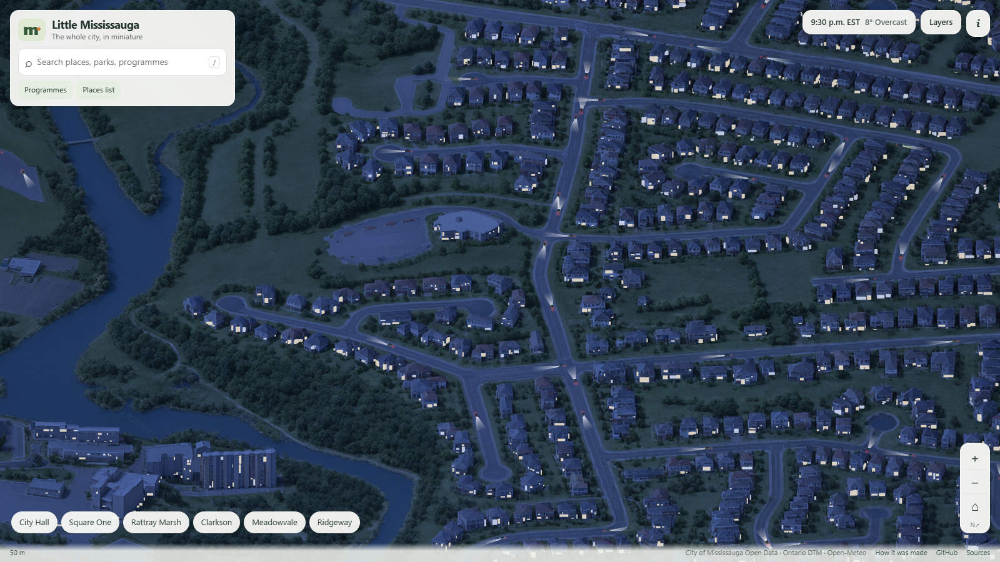
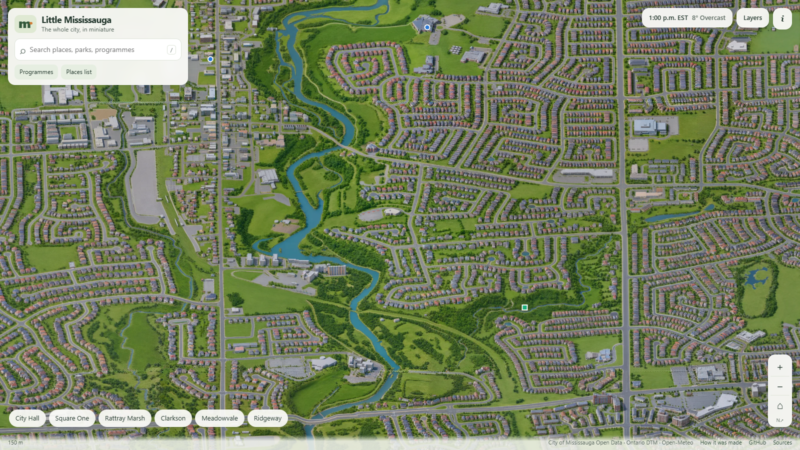

# Little Mississauga

**A hand-drawn-looking, RollerCoaster Tycoon 3–style isometric map of the whole City of Mississauga, built from real open data and a small fine-tuned image model.**

**Live: [sauga.mohameda.li](https://sauga.mohameda.li)**





Every building is the City's own published 3D massing model. Every hill is the Province's lidar-derived terrain. Every road, parking lot, creek and woodlot is a municipal map polygon. A fine-tuned Qwen-Image adapter repaints that geometry as one continuous miniature city. Then the browser brings it to life: the sun follows real Toronto time, the weather comes from a live forecast feed, windows light up at dusk, and simulated traffic drives the real street network with headlights on at night.

It is also an activity-discovery map: community centres and real programmes from Active Mississauga, linking out to the City's own registration pages.

## Highlights

- **One seamless canvas, not a collage.** 232 overlapping 2240 px blocks at 0.5 m/px, joint-sampled so that every overlap shares one latent and one noise field. Finished neighbours are pinned while their shared strips are regenerated. There are no visible tile edges.
- **Real geography only.** Official LOD2 building massing (all 30 City archives), the Ontario DTM in CGVD2013 heights, and City planimetric roads, parking, water and woodland. NoData is never invented. The only exception is the Lake Ontario surface, which sits at the DTM's own shoreline elevation and only under mapped lake water.
- **Life layers.** About 25,000 simulated cars follow the City's official street centrelines, at heights from the terrain, and disappear behind buildings using a source-aligned occlusion mask. At night their headlights throw lit cones across the pavement. Window light cells come from the source facade pass, with stable per-pane occupancy.
- **Time and weather.** A continuous solar clock (America/Toronto, DST-aware) and a fixed-Mississauga Open-Meteo estimate drive grading, wet streets, rain and snow. No location tracking.
- **Deep zoom.** A multiscale WebP pyramid. The browser fetches only the tiles in view.

## How it was made

The full write-up, with numbers, is in [docs/how-it-works.md](docs/how-it-works.md). In short:

1. **Source scenes.** Each block is rendered in a headless browser from the real 3D city: a fixed 30° pitch, 45° heading orthographic camera in one shared EPSG:26917 / CGVD2013 frame.
2. **Style model.** A rank-32 LoRA on Qwen-Image 2.1, trained for 1,000 steps on 145 reviewed source→artwork pairs.
3. **City-scale sampling.** Nine 896 px windows per block, with FP32-blended predictions and one global scheduler step per denoising step. Windows are batched, each keeps its own text and source-image KV prefix, and 20 base steps are used. A canary showed this matches the 40-step look at half the cost; Turbo LoRAs lost the style.
4. **Tiles and life.** Blocks are cross-faded across their 448 px overlaps into a deep-zoom pyramid. Road and window masks share the same pixel grid.

## Repository layout

```
site/                 Static web app (no build step)
  app.js              Map, UI, lighting and weather wiring
  citywide-traffic.mjs  Streaming simulated traffic, occlusion and headlight cones
  map-core.mjs, projection.mjs, runtime-motion.mjs, weather.mjs, lighting/
  data/, atlas.json   Places, parks, cycling, programmes (public open data)
pipeline/             Reference production pipeline (Python)
  sources/            Per-block geometry, terrain and capture
  generate/           Citywide joint sampler (encode, generate, decode, with S3 checkpoints)
  tiles/              Mosaic, deep-zoom pyramid, occlusion and window masks, site assembly
  life/               Street-centreline traffic routes with terrain heights
scripts/              Deploy helpers
.github/workflows/    CI and deployment to S3 and CloudFront via GitHub OIDC
docs/                 Write-up and images
```

Generated artwork tiles are not stored in git. They live in a private art store and are copied server-side into each immutable release during deployment.

## Deployment

Every push to `main` that touches `site/` runs **Deploy**:

1. Syntax-check modules and validate JSON.
2. Assume a narrowly scoped AWS role via GitHub OIDC. There are no stored keys.
3. Build an immutable `releases/gh-<sha>` prefix: art tiles copied server-side, plus the app.
4. Point the site's CloudFront origin at it, with an ETag-conditional update, then invalidate.
5. Smoke-test the live site and check file hashes against the repo.

Rolling back means re-pointing the origin at a previous release prefix (`scripts/switch_origin.py`).

## Honest limits

- The artwork is illustrative, not survey-grade. Building bases, bridge decks and engineered road grades are not verified.
- City Centre uses the City's attributed building records. Unattributed detailed duplicates and a proposed-development massing in the source archive were reviewed and excluded, and the Civic Centre uses its verified detailed model.
- Traffic is simulated ambience, not live traffic. Window lights are inferred cells, not real occupancy.
- Programme data is a dated partial sample. The City's pages are authoritative.

## Credits and licences

- Code: MIT (see [LICENSE](LICENSE)).
- Model: Qwen-Image under its research licence ([site/LICENSE-QWEN.txt](site/LICENSE-QWEN.txt)). This is a noncommercial research demonstration, and no weights are distributed.
- Data: City of Mississauga Open Data (3D massing, planimetrics, street centrelines, parks, cycling, boundary), Ontario Digital Terrain Model, Natural Earth (offshore lake context), and Open-Meteo (CC BY 4.0). See [site/NOTICE.txt](site/NOTICE.txt).
- Inspiration: John Fewell's [Slop Toronto](https://iso.sloptoronto.ca/how) and Tiny Toronto. No assets from either are used.

Independent project; not affiliated with the City of Mississauga.
